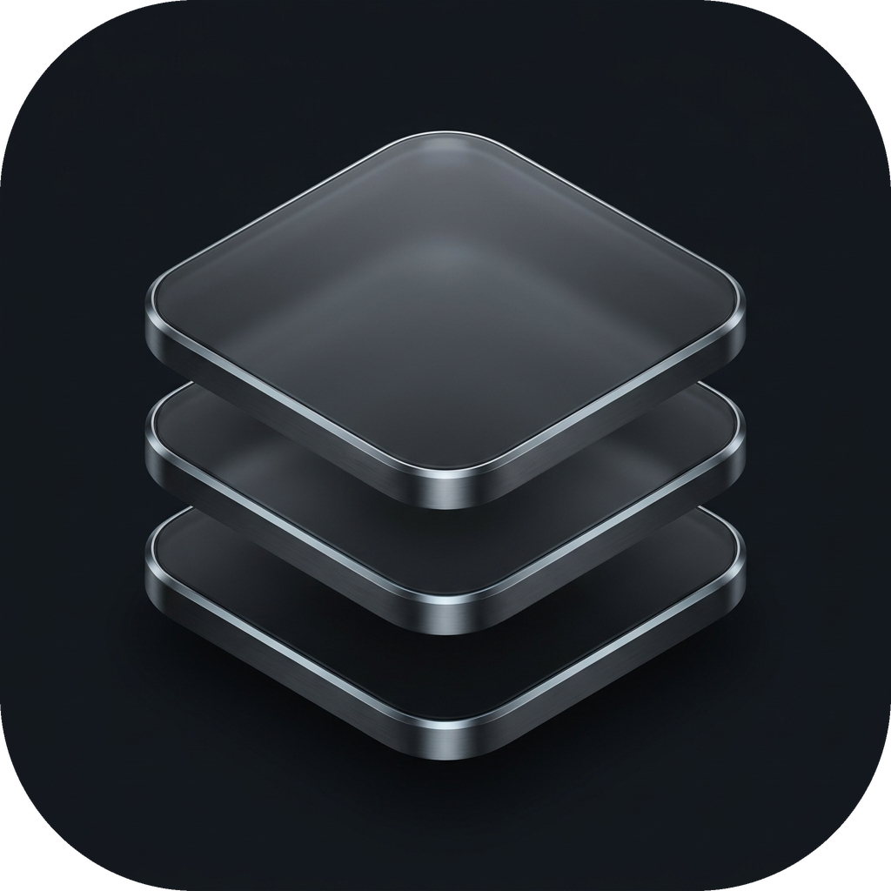
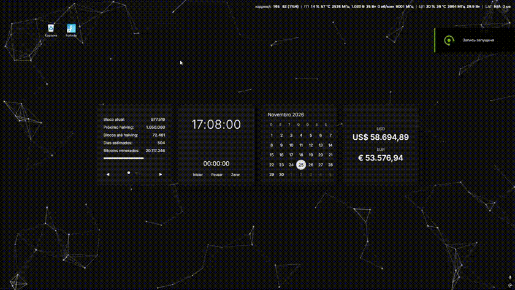

<p align="center">
  
</p>

<h1 align="center">FluxDesk</h1>

<p align="center">
  Lightweight, private desktop workspace manager for Windows 10 & 11 with native shell redirection and zero telemetry.
</p>

## Demo



[Watch full-resolution video (MP4)](https://github.com/l1vensi/FluxDesk/raw/main/assets/demo.mp4)

## Features

- **Native Shell Redirection**: Official Windows Known Folder API integration (`SHSetKnownFolderPath`).
- **Physical Workspace Isolation**: Each desktop is an independent directory on disk.
- **Pixel-Accurate Icon Memory**: Restores custom icon layouts per workspace via ListView memory inspection.
- **Wallpaper Engine Integration**: Full live wallpaper support with automatic Steam library detection, visual gallery picker, silent background execution, and graceful fallback.
- **Independent Wallpapers**: Assign static images (`.jpg`, `.png`, `.bmp`) or live wallpapers per workspace with instant application and multi-desktop bulk assignment.
- **Low-Latency Switcher**: Hardware-accelerated quick switcher (`Alt + W`) with live preview cards, instant toggle, and zero focus stealing in games.
- **High-Performance Preview Engine**: Dedicated STA icon caching rendering multi-icon desktop previews in under 15ms.
- **Hotkeys**: Customizable switching hotkeys (`Alt + 1` through `Alt + 9`).
- **Data Protection**: Safe deletion with optional Recycle Bin support; automatic primary desktop restoration on system shutdown.
- **Zero Telemetry**: Fully offline, local, and private.

## Architecture

- `FluxDesk.UI`: Modern WPF configuration window and workspace management dashboard.
- `FluxDesk.Daemon`: Background WinForms worker process hosting low-level keyboard hooks, icon layout restoration, and shell redirection.

## Building from Source

Requirements:
- .NET 8.0 SDK (x64)
- Windows 10 (version 1809+) or Windows 11

```powershell
# Clone repository
git clone https://github.com/l1vensi/FluxDesk.git
cd FluxDesk\src

# Build solution
dotnet build FluxDesk.sln -c Release
```

## Contributors

- [l1vensi](https://github.com/l1vensi) — Author & Lead Developer
- [gemini-code-assist](https://github.com/apps/gemini-code-assist) — Co-author & AI Pair Programmer

## License

This software is released under open-source terms. See the LICENSE file for details.
